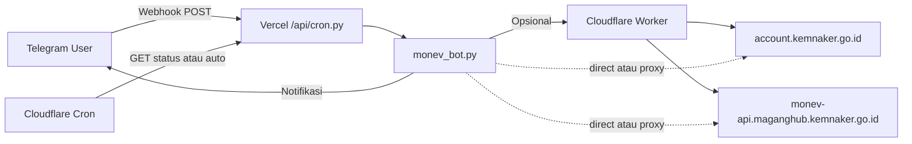

# Monev ADE7 Reminder — MagangHub Kemnaker

Bot Telegram untuk membantu memantau status presensi dan logbook MagangHub Kemnaker (SIAPkerja). Aplikasi ini menggunakan Python standard library, endpoint serverless Vercel, Cloudflare Worker sebagai jalur koneksi opsional, serta webhook Telegram.

> **Penting:** Gunakan aplikasi ini hanya untuk akun dan aktivitas yang memang menjadi hak Anda. Pastikan seluruh data presensi, lokasi, dan logbook yang dikirim sesuai kondisi sebenarnya serta mematuhi kebijakan MagangHub/Kemnaker. Jangan menyimpan kredensial di repository publik.

[](https://www.python.org/)
[](https://vercel.com/)
[](https://workers.cloudflare.com/)
[](https://t.me/Cekad_bot)
[](LICENSE)

## Daftar Isi

- [Gambaran Umum](#gambaran-umum)
- [Arsitektur](#arsitektur)
- [Fitur](#fitur)
- [Jadwal Otomatisasi](#jadwal-otomatisasi)
- [Perintah Telegram](#perintah-telegram)
- [Struktur Proyek](#struktur-proyek)
- [Konfigurasi Environment](#konfigurasi-environment)
- [Instalasi Lokal](#instalasi-lokal)
- [Deployment](#deployment)
  - [Vercel](#deployment-vercel)
  - [Cloudflare Worker](#deployment-cloudflare-worker)
  - [Webhook Telegram](#mengaktifkan-webhook-telegram)
- [Pengujian dan Diagnostik](#pengujian-dan-diagnostik)
- [Keamanan dan Batasan](#keamanan-dan-batasan)
- [Pemecahan Masalah](#pemecahan-masalah)
- [Lisensi](#lisensi)

---

## Gambaran Umum

Monev ADE7 Reminder menyediakan:

- pemeriksaan status presensi hari ini secara read-only;
- autentikasi SSO Kemnaker dan caching token sementara;
- pengisian presensi dan daily log melalui fungsi terpusat;
- notifikasi status melalui Telegram;
- auto-retry pada jadwal pemantauan sore dan malam apabila presensi belum tercatat;
- rekapitulasi presensi tujuh hari terakhir;
- pilihan kegiatan kustom melalui perintah `/isi <kegiatan>`;
- Cloudflare Worker opsional untuk meneruskan request ke layanan Kemnaker;
- proteksi akhir pekan, deduplikasi update Telegram, dan debounce trigger agar proses tidak dijalankan berulang.

Aplikasi tidak menggunakan framework Python pihak ketiga. Dependensi runtime utama berasal dari standard library seperti `urllib`, `http.cookiejar`, `json`, `os`, `tempfile`, dan `datetime`.

## Arsitektur



### Komponen

- **`api/cron.py`** — handler Vercel untuk webhook Telegram, setup webhook, endpoint status, endpoint auto-monev, dan diagnostik.
- **`monev_bot.py`** — autentikasi, client API, pemeriksaan presensi, pemilihan template, submit daily log, notifikasi, dan rekap.
- **Cloudflare Worker** — reverse proxy opsional dan scheduler Cloudflare Cron.
- **Telegram** — antarmuka interaktif untuk menjalankan pemeriksaan dan tindakan manual.

## Fitur

- **Guard check:** memeriksa presensi hari ini sebelum mengirim data baru.
- **SSO dan cache token:** token disimpan sementara di memori dan direktori temporary runtime; token kedaluwarsa akan memicu login ulang.
- **Template logbook:** memilih template yang belum tercatat pada `used_templates.json` dan melakukan sinkronisasi terbatas dengan riwayat daily log.
- **Kegiatan kustom:** mengirim aktivitas yang diberikan pengguna melalui `/isi <kegiatan>` setelah konfirmasi.
- **Kontrol Telegram:** hanya `TELEGRAM_CHAT_ID` yang diizinkan jika variabel tersebut dikonfigurasi.
- **Proteksi webhook:** dukungan `TELEGRAM_WEBHOOK_SECRET` untuk memvalidasi header webhook Telegram.
- **Proteksi cron:** dukungan `CRON_SECRET` untuk endpoint `auto` dan setup webhook.
- **Deduplication dan debounce:** update Telegram duplikat dilewati dan trigger yang sama dikunci selama 15 menit.
- **Weekend protection:** jadwal otomatis tidak menjalankan status, pengingat, atau auto-monev pada Sabtu dan Minggu kecuali dipaksa secara eksplisit untuk pengujian.

## Jadwal Otomatisasi

Semua waktu di bawah menggunakan WIB (UTC+7). Cron Cloudflare menggunakan UTC.

| Waktu WIB | Cron UTC | Mode | Perilaku |
|:---:|:---:|:---|:---|
| 09:00, Senin–Jumat | `0 2 * * 1-5` | `status&waktu=pagi` | Memeriksa koneksi, SSO, dan status presensi. |
| 15:00, Senin–Jumat | `0 8 * * 1-5` | `auto` | Menjalankan auto-monev jika presensi belum tercatat. |
| 18:00, Senin–Jumat | `0 11 * * 1-5` | `status&waktu=sore` | Memeriksa status dan mencoba auto-retry jika masih kosong. |
| 21:00, Senin–Jumat | `0 14 * * 1-5` | `status&waktu=malam` | Pemeriksaan terakhir, cuplikan kegiatan, dan auto-retry bila diperlukan. |

`vercel.json` saat ini mengonfigurasi fallback Vercel Cron untuk mode `auto` pada `0 8 * * 1-5`. Jadwal status lainnya dijalankan melalui Cloudflare Worker atau trigger eksternal yang Anda konfigurasi.

> **Akhir pekan:** handler menolak proses otomatis pada Sabtu dan Minggu dengan respons `weekend_skipped`, kecuali parameter `force` digunakan secara sengaja.

## Perintah Telegram

Bot default yang digunakan proyek ini adalah [`@Cekad_bot`](https://t.me/Cekad_bot).

| Perintah | Fungsi |
|:---|:---|
| `/start`, `/help`, `/bantuan` | Menampilkan menu utama dan tombol interaktif. |
| `/cek`, `/status` | Memeriksa status presensi hari ini tanpa submit data. |
| `/tes` | Menguji koneksi SSO, API, dan jalur proxy tanpa submit presensi. |
| `/monev` | Membuka dialog konfirmasi untuk pengisian otomatis. |
| `/isi <kegiatan>` | Membuka dialog konfirmasi untuk mengirim kegiatan kustom. |
| `/rekap` | Menampilkan ringkasan presensi tujuh hari terakhir. |
| `/sisa`, `/template`, `/templates` | Menampilkan jumlah template terpakai dan tersisa. |
| `/proxy` | Menampilkan status `CLOUDFLARE_WORKER_URL`. |
| `ya`, `/ya` | Mengonfirmasi tindakan yang sedang menunggu konfirmasi. |
| `/batal`, `/tidak` | Membatalkan tindakan yang sedang menunggu konfirmasi. |

## Struktur Proyek

```text
monev/
├── api/
│   └── cron.py                 # Handler Vercel: webhook, status, auto, dan diagnostik
├── tests/                      # Pengujian proyek
├── .env.example                # Contoh konfigurasi environment
├── .github/                    # Konfigurasi GitHub
├── cloudflare_worker.js        # Reverse proxy dan Cloudflare Cron handler
├── monev_bot.py                # Logika utama aplikasi
├── telegram_polling.py         # Pengujian bot lokal menggunakan polling
├── templates.json              # Template kegiatan, pembelajaran, dan kendala
├── reminder_templates.json     # Variasi pesan pengingat/status
├── used_templates.json         # Riwayat template yang telah dipakai
├── pyproject.toml              # Metadata proyek dan entrypoint Vercel
├── requirements.txt            # Daftar dependensi proyek
├── vercel.json                 # Konfigurasi Vercel
├── wrangler.toml               # Konfigurasi Cloudflare Worker
├── README_BOT.md               # Dokumentasi ringkas bot
└── README.md                   # Dokumentasi utama
```

## Konfigurasi Environment

Salin `.env.example` menjadi `.env` untuk pengujian lokal. Untuk deployment, masukkan variabel yang sama melalui pengaturan environment platform masing-masing.

| Variabel | Wajib | Keterangan |
|:---|:---:|:---|
| `KEMNAKER_USERNAME` | Ya | NIK atau username akun SIAPkerja. |
| `KEMNAKER_PASSWORD` | Ya | Password akun SIAPkerja. |
| `OFFICE_LAT` | Ya | Latitude lokasi presensi yang sah. |
| `OFFICE_LONG` | Ya | Longitude lokasi presensi yang sah. |
| `TELEGRAM_BOT_TOKEN` | Ya | Token bot dari `@BotFather`. |
| `TELEGRAM_CHAT_ID` | Ya | Chat ID Telegram yang diizinkan menerima dan menjalankan bot. |
| `CLOUDFLARE_WORKER_URL` | Disarankan | URL Worker jika koneksi Kemnaker perlu diteruskan melalui Cloudflare. |
| `CRON_SECRET` | Disarankan | Secret untuk melindungi endpoint `auto` dan setup webhook. |
| `TELEGRAM_WEBHOOK_SECRET` | Disarankan | Secret untuk validasi header webhook Telegram. |
| `KEMNAKER_BEARER_TOKEN` | Opsional | Token Bearer manual; gunakan hanya jika memang tersedia dan dikelola secara aman. |

Contoh konfigurasi tersedia di [`.env.example`](.env.example). Jangan commit file `.env` atau token aktif.

## Instalasi Lokal

### Prasyarat

- Python 3.11 atau lebih baru;
- akun SIAPkerja/MagangHub yang sah;
- bot Telegram dari `@BotFather`;
- kredensial Cloudflare/Vercel jika melakukan deployment.

### Langkah instalasi

```bash
git clone https://github.com/ade781/monev.git
cd monev

cp .env.example .env
# Edit .env dan isi nilai yang benar

python --version
python -m unittest discover -s tests -v
```

`requirements.txt` tidak memerlukan package eksternal. Jika ingin menggunakan virtual environment:

```bash
python -m venv .venv
source .venv/bin/activate        # Linux/macOS
# .venv\\Scripts\\activate       # Windows PowerShell

python -m unittest discover -s tests -v
```

## Deployment

### Deployment Vercel

1. Import repository `ade781/monev` ke Vercel.
2. Pastikan runtime Python membaca entrypoint `api/cron.py`.
3. Tambahkan environment variables pada **Settings → Environment Variables**.
4. Deploy project.
5. Catat URL deployment, misalnya `https://nama-project.vercel.app`.
6. Jika menggunakan `CRON_SECRET`, pastikan secret yang sama tersedia pada pemanggil cron.

Konfigurasi `vercel.json` menetapkan region `sin1`, durasi fungsi maksimum 60 detik, dan satu Vercel Cron untuk mode `auto`.

### Deployment Cloudflare Worker

Cloudflare Worker bersifat opsional. Gunakan jika Anda membutuhkan reverse proxy atau ingin menjalankan scheduler Cloudflare.

Dengan Wrangler:

```bash
npx wrangler login
npx wrangler deploy
```

Konfigurasi scheduler berada di [`wrangler.toml`](wrangler.toml):

```toml
[triggers]
crons = ["0 2 * * 1-5", "0 8 * * 1-5", "0 11 * * 1-5", "0 14 * * 1-5"]
```

Atur variable Worker berikut melalui dashboard Cloudflare atau Wrangler:

- `VERCEL_DOMAIN` — URL deployment Vercel tanpa slash penutup;
- `CRON_SECRET` — gunakan nilai yang sama dengan Vercel jika endpoint dilindungi.

Kemudian masukkan URL Worker ke `CLOUDFLARE_WORKER_URL` di Vercel.

> Worker meneruskan URL target melalui parameter query `url`. Batasi penggunaan Worker pada endpoint yang memang diperlukan dan jangan menjadikannya proxy publik tanpa kontrol akses.

### Mengaktifkan Webhook Telegram

Setelah deployment Vercel selesai, aktifkan webhook dengan membuka endpoint berikut. Jika `CRON_SECRET` diaktifkan, sertakan secret sebagai query parameter atau gunakan header Authorization.

```text
https://<domain-vercel-anda>/api/cron?setup=1
```

Dengan secret melalui query parameter:

```text
https://<domain-vercel-anda>/api/cron?setup=1&secret=<CRON_SECRET>
```

Respons akan berisi URL webhook dan hasil dari Telegram Bot API. Setelah berhasil, kirim `/start` ke bot.

## Pengujian dan Diagnostik

### Cek koneksi SSO dan profil

```bash
python -c "import monev_bot; print(monev_bot.test_koneksi_sistem())"
```

### Cek status presensi hari ini

```bash
python -c "import monev_bot; print(monev_bot.format_status_presensi())"
```

### Menjalankan polling Telegram secara lokal

```bash
python telegram_polling.py --force
```

### Diagnostik melalui endpoint Vercel

```text
https://<domain-vercel-anda>/api/cron?test=1
```

Endpoint ini memeriksa kesehatan koneksi dan tidak dimaksudkan untuk mengirim presensi.

## Keamanan dan Batasan

- Simpan `KEMNAKER_PASSWORD`, token Telegram, Bearer token, dan secret webhook hanya di environment variables.
- Jangan mencetak token ke log atau memasukkannya ke issue, commit, screenshot, maupun README.
- Atur `TELEGRAM_CHAT_ID` agar bot tidak merespons pengguna yang tidak berwenang.
- Aktifkan `TELEGRAM_WEBHOOK_SECRET` untuk memvalidasi request webhook Telegram.
- Aktifkan `CRON_SECRET` agar endpoint `auto` dan setup webhook tidak terbuka tanpa autentikasi.
- Runtime serverless memiliki filesystem yang sementara. Cache token, lock trigger, dan riwayat template dapat hilang ketika instance dibuat ulang; jangan menganggap filesystem `/tmp` sebagai penyimpanan permanen.
- Periksa kembali data lokasi dan isi logbook sebelum submit. Fitur otomatisasi tidak menggantikan kewajiban pengguna untuk memastikan data presensi benar.
- Endpoint proxy dan endpoint diagnostik dapat membocorkan informasi operasional jika dibiarkan tanpa pembatasan. Gunakan secret, domain yang tepat, dan prinsip least privilege.

## Pemecahan Masalah

### `401 Unauthorized` pada endpoint `auto` atau setup webhook

Pastikan nilai `CRON_SECRET` di Vercel dan Cloudflare sama. Jika secret aktif, request harus menyertakan:

```text
?secret=<CRON_SECRET>
```

atau header:

```text
Authorization: Bearer <CRON_SECRET>
```

### Webhook Telegram tidak menerima pesan

1. Pastikan `TELEGRAM_BOT_TOKEN` benar.
2. Jalankan kembali endpoint setup webhook.
3. Pastikan `TELEGRAM_WEBHOOK_SECRET` di Vercel sama dengan secret yang dipakai saat mendaftarkan webhook.
4. Pastikan URL deployment dapat diakses melalui HTTPS.
5. Kirim `/start` setelah webhook berhasil.

### Koneksi Kemnaker gagal atau menerima HTTP 403

1. Jalankan `/tes` atau endpoint `?test=1`.
2. Periksa `CLOUDFLARE_WORKER_URL`.
3. Pastikan Worker sudah aktif dan `VERCEL_DOMAIN` mengarah ke deployment yang benar.
4. Periksa log Vercel dan Cloudflare.
5. Pastikan layanan Kemnaker sedang dapat diakses dan kredensial masih valid.

### Template tidak berkurang atau riwayat hilang

Filesystem serverless tidak persisten. `used_templates.json` dapat ditulis ke direktori temporary ketika root project read-only. Untuk kebutuhan riwayat permanen, gunakan storage eksternal yang sesuai dan jangan menaruh kredensial di file repository.

## Lisensi

Proyek ini didistribusikan di bawah lisensi [MIT](LICENSE).
